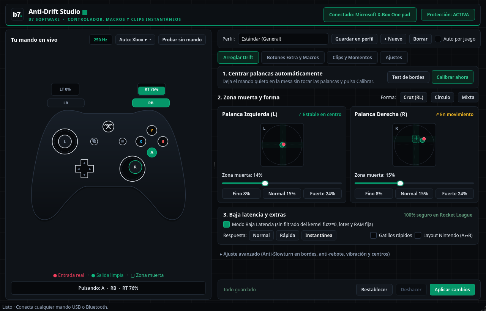
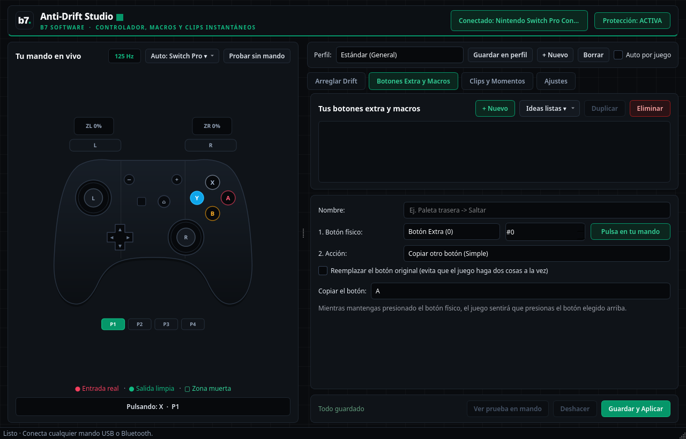
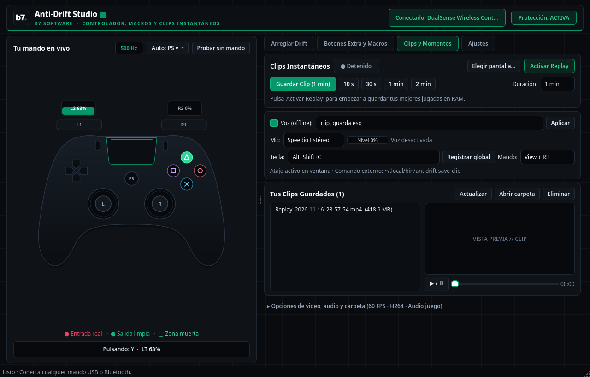
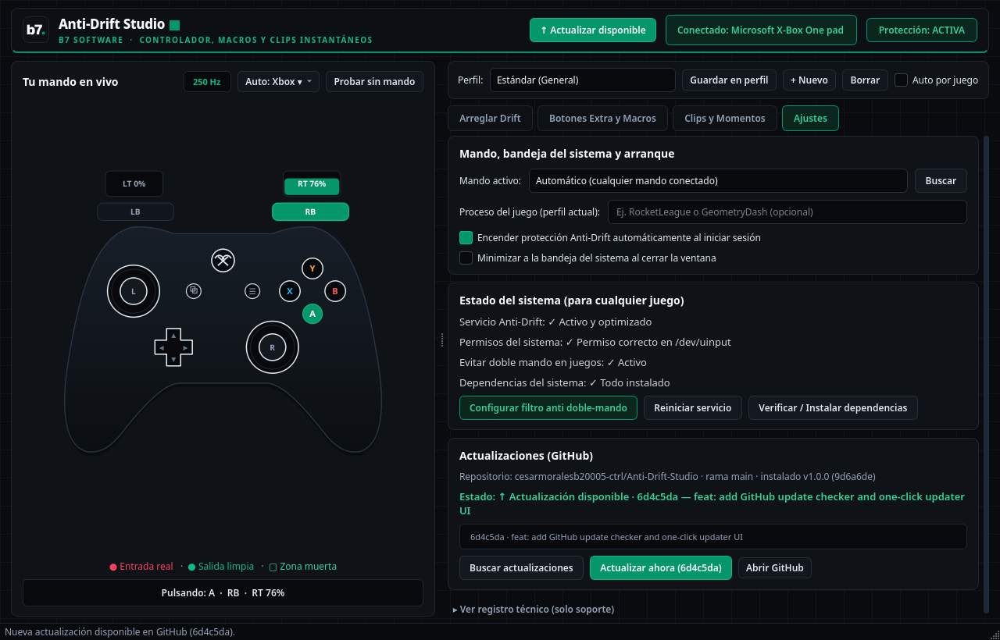

# Anti-Drift Studio

Herramienta universal para Linux (daemon en C + interfaz en Python/PySide6) que elimina el **drift** de cualquier mando (**Xbox**, **PlayStation DualSense/DualShock**, **Nintendo Switch Pro / Joy-Con**, 8BitDo, GameSir o genéricos USB/Bluetooth), añade **remap / macros para botones extra** y graba **clips instantáneos estilo Moments** con activación por voz o teclado.



## Qué hace

- **Detección universal y vista previa dinámica**: detecta automáticamente tu mando y adapta la silueta en vivo (**Xbox One / Series**, **PlayStation**, **Nintendo Switch Pro** o **Joy-Con**), adaptándose también a los rangos hardware reales (`0..255`, `-32768..32767`, gatillos analógicos o digitales).
- **Calibración completa y Anti-Slowturn**: centrado en 1 clic, zona muerta elegible (**Cruz/Axial**, **Círculo/Radial** o **Mixta**), **test de circularidad y desgaste** para compensar bordes que ya no llegan al 100%, y filtro **anti-rebote (Debounce)** para botones desgastados.
- **Baja latencia y respuesta**: `fuzz=0` en `uinput`, lectura/escritura en bloque, memoria fijada en RAM (`mlockall`), curvas de respuesta (**Normal / Rápida / Instantánea**) y gatillos instantáneos (**Hair-Trigger**).
- **Perfiles por juego y extras**: cambio manual o automático al abrir un juego (*Rocket League*, *Geometry Dash*, *FPS*), passthrough de vibración con control `0–100%`, **Layout Nintendo (`A↔B`, `X↔Y`)**, medidor de frecuencia en **Hz**, y bandeja del sistema.
- **Botones extra y macros**: captura cualquier botón o paleta trasera presionándolo en el mando físico y asígnale un remap simple 1:1, modo Turbo o un combo paso a paso.
- **Clips Instantáneos (estilo Moments)**: búfer en RAM con **GPU Screen Recorder** (`10 s – 5 min`, audio de juego + micrófono, visor integrado), **activación por voz 100% offline con frase editable** (Vosk) y **atajos globales** (Portal Wayland, `evdev`, mando o CLI `~/.local/bin/antidrift-save-clip`).
- **Gestor de actualizaciones desde GitHub**: comprueba nuevas versiones en el repositorio de GitHub y muestra un botón directo para actualizar en 1 clic desde la interfaz.
- **Máxima compatibilidad con juegos**: expone un mando virtual estándar `"Microsoft X-Box 360 pad"` para Steam, Proton, Lutris, Heroic, Epic Games y juegos nativos de Linux.

## Capturas

| Botones Extra, Paddles y Macros (Switch Pro) | Clips Instantáneos y Activación por Voz (DualSense) |
| :---: | :---: |
|  |  |

| Ajustes, Diagnóstico y Gestor de Actualizaciones |
| :---: |
|  |

## Instalación rápida

Requisitos del sistema: `gcc`, `python3` (con módulo `venv`), `systemd --user` (las dependencias por distribución se detectan e instalan automáticamente al configurar).

```bash
./install.sh
```

Para abrir la aplicación:

```bash
./run.sh
```

O búscala en tu menú de aplicaciones como **Anti-Drift Studio**.

## Permisos `/dev/uinput` (si un sistema los restringe)

Si la pestaña **Ajustes** muestra aviso sobre `/dev/uinput`:

```bash
echo 'KERNEL=="uinput", MODE="0660", GROUP="input", TAG+="uaccess"' | sudo tee /etc/udev/rules.d/99-antidrift-uinput.rules
sudo usermod -aG input "$USER"
sudo udevadm control --reload-rules && sudo udevadm trigger
```

*(Cierra y vuelve a iniciar sesión después de agregar tu usuario al grupo `input`.)*

## Desinstalación

```bash
./uninstall.sh
```

## Licencia

Distribuido bajo la licencia **GNU General Public License v3.0 (GPL-3.0-or-later)**. Consulta el archivo [LICENSE](LICENSE) para más detalles.
